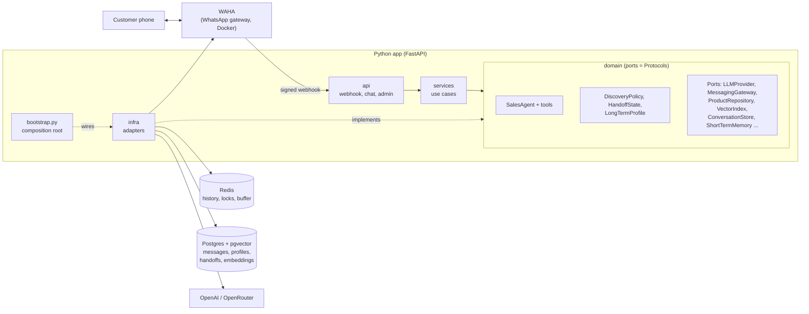
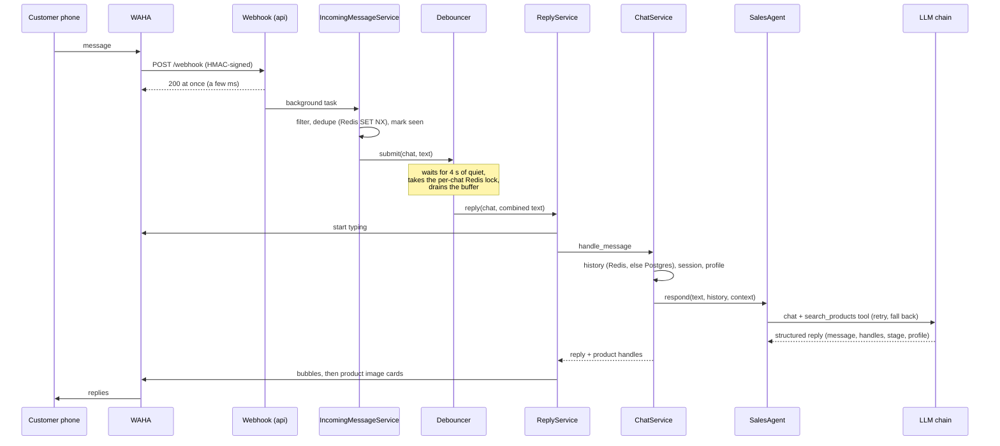

# Okhtein WhatsApp sales bot

A friendly AI stylist ("Nour") that chats with customers of [Okhtein](https://eg.okhtein.com) (Egyptian luxury
accessories) on WhatsApp. She finds out what the customer wants, one warm question at a time, and sends real
product recommendations as picture cards with the correct links. She replies in Egyptian Arabic, English or
Franco-Arabic, remembers the conversation and returning customers, answers store questions from an editable
knowledge file, and hands the chat to a person when she should.

It is also a **learning project**: the code is layered (ports and adapters), small and tested, and every design
choice is explained in [`docs/issues/`](docs/issues/README.md).

## What it does

| Customer says / does | The bot |
|---|---|
| "عايزة شنطة" (vague) | asks ONE friendly question, shows nothing yet; at most 3 questions, then recommends |
| "black clutch under 60000" (specific) | recommends 2-3 in-stock products within budget, each with a reason, as image cards |
| "show me a cheaper one" | remembers the conversation (Redis, backed by Postgres) and adjusts |
| "can I return an item?" | answers from `data/knowledge.md` only; unknown things ("shipping fee?") get "a team member will confirm" |
| "where is my order?" / angry / "I want a person" | hands off to the team, stays silent until released |
| comes back after a few days | welcomes them back and remembers their taste |
| sends 3 messages in a row | waits for them to finish and replies once, with typing indicator |
| OpenAI is down | falls back to OpenRouter; if everything fails, sends a warm holding message |

## Architecture



**The dependency rule:** `api → services → domain ← infra`. The domain defines *ports* (small
`typing.Protocol` interfaces) and imports no SDK and no framework; a test enforces this
(`tests/unit/test_domain_purity.py`). `infra` holds the *adapters* that implement the ports (OpenAI, Redis,
Postgres, WAHA, files). Everything is wired in one place, [`app/bootstrap.py`](app/bootstrap.py).

### One message, end to end



### Layers and folders

```
app/
  api/        FastAPI routes: webhook, chat, admin, health (thin: parse, call a service, respond)
  services/   use cases: IncomingMessageService, Debouncer, ReplyService, ChatService, MemoryService,
              HandoffService, ReturningCustomerService, EmbeddingIndexer
  domain/     business rules + ports: agent/, tools/, retrieval/, llm/ (fallback chain), discovery,
              handoff, long_term_profile, models, ports, errors   (no third-party imports)
  infra/      adapters: llm/, cache/ (Redis), db/ (Postgres, pgvector), whatsapp/ (WAHA), catalog/
  core/       settings, logging with phone masking, privacy helpers
  bootstrap.py  the composition root
data/         catalog (products.json, extracted from the store) + knowledge.md (editable FAQ)
scripts/      check_infra, build_embeddings, eval_retrieval, run_load_test, extract_catalog
tests/        unit/ (fakes, no network), integration/ (real Docker services), evals/ (conversation + retrieval)
loadtests/    Locust files, burst check, real-LLM smoke test
docs/         issues/ (the 13 slices), demo-script, eval + load-test results, morning-checklist
```

## Setup from zero

You need: **Docker Desktop** (with WSL2 on Windows), **Python 3.11+**, an **OpenAI API key**, and a
WhatsApp account on a spare **test phone** (WAHA is an unofficial gateway: never link a number you cannot
afford to lose, and never message anyone but test numbers).

```bash
git clone <this repository> okhtein-bot && cd okhtein-bot
python -m venv .venv && source .venv/Scripts/activate        # Windows Git Bash; on Linux/macOS: .venv/bin/activate
pip install -e ".[dev]"
cp .env.example .env
```

Edit `.env` yourself (never paste secrets into chats or commits). The ones you must set:

| Setting | What to put |
|---|---|
| `OPENAI_API_KEY` | your OpenAI key |
| `POSTGRES_PASSWORD` | any password you invent |
| `WAHA_API_KEY` | any long random string (also the WAHA dashboard password) |
| `WAHA_WEBHOOK_HMAC_KEY` | any long random string (WAHA signs webhooks with it) |
| `ALLOWED_NUMBERS` | comma-separated numbers the bot may answer (your test phone). Newer WhatsApp may show a customer as an internal `…@lid` id: if the log says "sender not in the allowed list", add that id too |
| `OPENROUTER_API_KEY` | optional: enables the fallback provider |
| `ADMIN_API_KEY`, `STAFF_PHONE` | optional: protects the release endpoint; the number that gets handoff alerts |

Generate a random secret with `python -c "import secrets; print(secrets.token_hex(24))"`. If something
else on your machine already uses port 5432 (a native Postgres on Windows is common), set `POSTGRES_PORT=5433`.

Start the infrastructure and check it:

```bash
docker compose up -d                 # Postgres (pgvector), Redis, WAHA; all should become "healthy"
docker compose ps
python scripts/check_infra.py        # ✅ Postgres  ✅ Redis  ✅ WAHA
```

Connect WhatsApp once (the session lives in a Docker volume and survives restarts):

1. Open <http://localhost:3000/dashboard>, log in as `admin` with your `WAHA_API_KEY` as the password.
2. Workers → edit the WAHA worker, enter the API key, connect.
3. Sessions → Start New → name it exactly `default`. In its *Chats* settings turn **Status** off.
4. Scan the QR code from the test phone (WhatsApp → Linked devices → Link a device).

Build the product search index, then run the app:

```bash
python scripts/build_embeddings.py   # embeds the catalog into pgvector (a second run embeds nothing)
uvicorn app.main:app --host 0.0.0.0 --port 8000
```

`--host 0.0.0.0` matters: WAHA runs in Docker and reaches the app at `host.docker.internal:8000`.
Now message the linked number from your test phone. Without WhatsApp you can chat over HTTP:

```bash
curl -X POST http://127.0.0.1:8000/chat -H "Content-Type: application/json" \
     -d '{"chat_id":"demo","text":"I want a black clutch under 60000"}'
```

(Use `127.0.0.1`, not `localhost`: on Windows `localhost` tries IPv6 first and adds ~2 s per new connection.)
Interactive API docs: <http://127.0.0.1:8000/docs>.

## Testing

```bash
ruff check . && ruff format --check . && mypy app && pytest     # the quality gate: unit tests, no network, no Docker
pytest -m integration                                           # needs `docker compose up -d`: real Redis, Postgres, pgvector
python -m tests.evals.run_conversations                         # 17 scripted customers vs the REAL agent; rules + LLM judge
python scripts/eval_retrieval.py                                # hit@3 for keyword vs vector vs hybrid search
python scripts/run_load_test.py                                 # Locust: capacity + burst correctness (fake LLM/WhatsApp)
```

- **Unit tests** use fakes of the ports (`FakeLLM`, `FakeGateway`, in-memory stores, fakeredis), never mocks of internals.
- **Conversation evals** measure friendliness, not just correctness: code rule checks (no products on a vague first reply, budget respected, language, no gendered address, no instruction leaks, never offers what it cannot do) plus an LLM judge scoring warmth, dialect, not-pushy, brevity and helpfulness. Latest run: [`docs/eval-report-latest.md`](docs/eval-report-latest.md) (average 4.85, all rules pass). It costs a few cents; run it when the prompt changes.
- **Retrieval eval:** hybrid 84% hit@3 vs keyword 60% on 25 labelled queries ([details](docs/issues/006-hybrid-retrieval.md)).
- **Load test:** webhook p95 23 ms with 0 failures at 100 simulated customers; 160/160 bursts got exactly one reply. See [`docs/load-test-results.md`](docs/load-test-results.md).

## Configuration

Everything is configured through environment variables / `.env`, read in exactly one place
([`app/core/config.py`](app/core/config.py)); [`.env.example`](.env.example) documents every one.

| Group | Settings (defaults) |
|---|---|
| Runtime | `ENVIRONMENT` (development), `LOAD_TEST_MODE` (false; fakes the LLM and WhatsApp for load tests, **refused when `ENVIRONMENT=production`**) |
| Store | `STORE_URL`, `STORE_CURRENCY` (EGP), `PRODUCTS_PATH`, `KNOWLEDGE_PATH` |
| LLM | `OPENAI_API_KEY`, `OPENAI_MODEL` (gpt-5-mini), `OPENROUTER_API_KEY`, `OPENROUTER_MODEL`, `OPENROUTER_BASE_URL`, `LLM_TIMEOUT_SECONDS` (45), `LLM_PROVIDER_ORDER` (openai,openrouter), `LLM_MAX_RETRIES` (2), `LLM_RETRY_BASE_DELAY_SECONDS` (0.5), `MAX_TOOL_ROUNDS` (5) |
| Agent | `PROMPT_VERSION` (v2), `SEARCH_RESULT_LIMIT` (5), `MAX_DISCOVERY_QUESTIONS` (3), `EVAL_JUDGE_MODEL` |
| Search | `RETRIEVER` (hybrid: keyword / vector / hybrid), `EMBEDDING_MODEL` (text-embedding-3-small), `EMBEDDING_BATCH_SIZE` |
| Redis | `REDIS_HOST`, `REDIS_PORT`, `REDIS_DB` |
| Postgres | `POSTGRES_HOST`, `POSTGRES_PORT`, `POSTGRES_USER`, `POSTGRES_PASSWORD`, `POSTGRES_DB` |
| WAHA | `WAHA_URL`, `WAHA_API_KEY`, `WAHA_SESSION` (default), `WAHA_WEBHOOK_URL`, `WAHA_WEBHOOK_HMAC_KEY`, `WAHA_TIMEOUT_SECONDS` |
| Memory | `SESSION_TTL_SECONDS` (86400), `HISTORY_LIMIT` (20), `PROFILE_SUMMARY_MAX_CHARS` (300), `PROFILE_PRODUCTS_SHOWN_LIMIT` (20) |
| Human-like sending | `DEBOUNCE_SECONDS` (4), `LOCK_TTL_SECONDS` (120), `LOCK_WAIT_SECONDS` (90), `MAX_BUBBLES` (3), `TYPING_SECONDS_PER_CHAR` (0.03), `TYPING_MAX_DELAY_SECONDS` (3), `SEND_RATE_LIMIT_PER_MINUTE` (20), `WEBHOOK_DEDUP_TTL_SECONDS` (3600) |
| Handoff and safety | `HANDOFF_TIMEOUT_HOURS` (12), `STAFF_PHONE`, `ADMIN_API_KEY`, `ALLOWED_NUMBERS` |

Day-to-day operations:

- **Edit store answers:** change `data/knowledge.md`; the next message uses it (no restart). Topics under "TODO for the store owner" are treated as *unknown* so the bot never invents them.
- **Release a handed-off chat:** `curl -X POST "http://127.0.0.1:8000/admin/chats/<chat_id>/release" -H "X-Admin-Key: $ADMIN_API_KEY"`
- **New or changed products:** re-run `python scripts/extract_catalog.py` then `python scripts/build_embeddings.py`.

## Design patterns: where each one lives

| Pattern | Where | What it does here |
|---|---|---|
| **Ports and adapters** (hexagonal) | `app/domain/ports.py` and everything in `app/infra/` | The domain depends on small Protocols; Redis, Postgres, OpenAI and WAHA are replaceable adapters |
| **Adapter** | [`WahaGateway`](app/infra/whatsapp/waha_gateway.py), [`OpenAICompatibleProvider`](app/infra/llm/openai_provider.py) | One class configured twice talks to OpenAI *and* OpenRouter |
| **Anti-corruption layer** | [`map_webhook`](app/infra/whatsapp/waha_mapper.py) | WAHA's JSON shape never leaks past this function |
| **Repository** | [`JsonProductRepository`](app/infra/catalog/json_repository.py), [`PostgresConversationStore`](app/infra/db/conversation_store.py), [`PostgresProfileStore`](app/infra/db/profile_store.py) | Storage hidden behind read/write interfaces |
| **Facade** | [`MemoryService`](app/services/memory_service.py) | Two-tier memory (Redis + Postgres) behind `record()` and `context()` |
| **Write-through / cache-aside** | `MemoryService.record` / `.context`; [`CachedHandoffStore`](app/infra/cache/redis_handoff_cache.py) | Postgres is the truth; Redis is a disposable cache that refills itself |
| **Decorator** | [`CachedHandoffStore`](app/infra/cache/redis_handoff_cache.py) | Adds Redis caching to any `HandoffStore` |
| **Strategy** | [`Retriever`](app/domain/retrieval/base.py): [`KeywordRetriever`, `VectorRetriever`, `HybridRetriever`](app/domain/retrieval/retrievers.py) | Search strategy chosen by `RETRIEVER`, no code change |
| **Chain of Responsibility / Composite** | [`FallbackLLMProvider`](app/domain/llm/fallback_chain.py), [`FallbackRetriever`](app/domain/retrieval/retrievers.py), [`CompositeStaffNotifier`](app/infra/whatsapp/staff_notifier.py) | Retry transient errors, then fall back; the caller sees one provider |
| **Command + Registry** | [`ToolRegistry`](app/domain/tools/base.py), [`SearchProductsTool`](app/domain/tools/search_products.py) | A new tool is a new class, not a new `elif` |
| **State machine** | [`HandoffState`](app/domain/handoff.py), stages in [`DiscoveryPolicy`](app/domain/discovery.py) | Explicit transitions; invalid ones are rejected |
| **Producer / consumer + debounce** | [`Debouncer`](app/services/debouncer.py) | Webhook produces, a background task consumes after the customer stops typing |
| **Distributed lock** | [`RedisChatLock`](app/infra/cache/redis_lock.py) | `SET NX PX` + owner-checked release: never two replies in flight for a chat |
| **Idempotency** | [`RedisIdempotencyStore`](app/infra/cache/redis_idempotency.py) | The same WAHA event delivered twice is handled once |
| **Rate limiting** | [`RedisRateLimiter`](app/infra/cache/redis_rate_limiter.py) | Caps outgoing messages per minute (protects the number) |
| **Factory** | [`ProductCardFactory`](app/services/product_cards.py) | Builds the picture-and-caption cards |
| **Dependency injection / composition root** | [`app/bootstrap.py`](app/bootstrap.py), FastAPI `Depends` in `app/api/` | All wiring in one place; tests swap in fakes via `dependency_overrides` |

## Known limits and ideas

- WAHA is an unofficial gateway: use a number you can lose, keep `ALLOWED_NUMBERS` set in testing, respect the rate limit. The official WhatsApp Cloud API is the production-grade alternative.
- The bot sends only text, bubbles and image cards; it cannot take orders, reserve items or track shipments (it says so and hands over).
- Replies take 10-40 s because the LLM needs 2-3 sequential calls (see the load-test results); a faster model for simple turns is the first optimisation.
- Schema changes use an idempotent patch at startup; a migration tool (Alembic) would be the next step.
- Voice notes and images from customers get a polite "text only for now".
- The conversation-eval judge is lenient; read the transcripts in the eval report as well as the scores.

## More documentation

- [`docs/issues/README.md`](docs/issues/README.md): the 13 build slices, with acceptance criteria and lessons
- [`docs/demo-script.md`](docs/demo-script.md): five conversations to run live
- [`docs/eval-report-latest.md`](docs/eval-report-latest.md) and [`docs/load-test-results.md`](docs/load-test-results.md)
- [`docs/morning-checklist.md`](docs/morning-checklist.md): manual checks that need a phone
